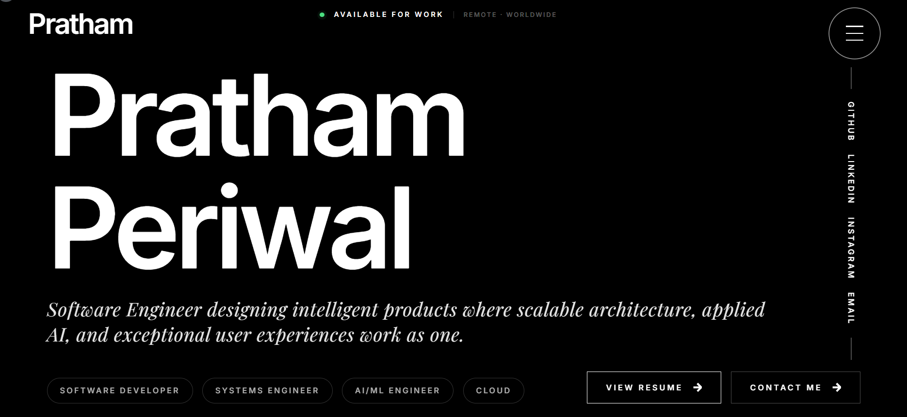

<div align="center">
  
  
  <h1>Pratham Periwal | Software Engineer</h1>
  
  <p align="center">
    <a href="https://react.dev/"></a>
    <a href="https://www.typescriptlang.org/"></a>
    <a href="https://vitejs.dev/"></a>
    <a href="https://tailwindcss.com/"></a>
    <a href="https://gsap.com/"></a>
    <a href="https://www.framer.com/motion/"></a>
    <a href="https://vercel.com/"></a>
    <a href="https://opensource.org/licenses/MIT"></a>
  </p>

  <p><strong>A technical, scalable portfolio demonstrating structured architecture, applied AI, and precise interaction design.</strong></p>

  <p>
    <a href="https://prathamperiwal.dev/">🌐 Live Demo</a>
    ·
    <a href="https://github.com/PrathamPeriwal/Portfolio-website">💻 GitHub Repository</a>
    ·
    <a href="https://www.linkedin.com/in/prathamperiwal/">💼 LinkedIn</a>
  </p>
</div>

---

## 🚀 At a Glance

- ⚛️ React + TypeScript + Vite
- 🎨 Tailwind CSS
- 🎬 GSAP + Framer Motion + Lenis
- 📱 Fully Responsive
- ⚡ Performance Focused
- 🚀 Deployed on Vercel

---

## 📑 Table of Contents

- [Project Snapshot](#-project-snapshot)
- [Overview](#-overview)
- [Tech Stack at a Glance](#-tech-stack-at-a-glance)
- [Features](#-features)
- [Technical Architecture](#-technical-architecture)
- [Engineering Decisions](#-engineering-decisions)
- [Folder Structure](#-folder-structure)
- [Section Breakdown](#-section-breakdown)
- [Design Philosophy](#-design-philosophy)
- [Animation System](#-animation-system)
- [Performance Optimizations](#-performance-optimizations)
- [Roadmap](#️-roadmap)
- [Installation & Local Development](#-installation--local-development)
- [Deployment](#️-deployment)
- [License](#-license)
- [Contact](#-contact)

## ⚡ Overview

This repository contains the source code for my personal portfolio, built to showcase software engineering projects through an editorial-inspired interface, carefully crafted animations, and a scalable React architecture.

Rather than serving as a traditional portfolio, the project is designed as an interactive user experience that combines modern frontend engineering, thoughtful interaction design, and performance-focused development. It demonstrates the technologies, architectural decisions, and engineering practices I use to build production-ready applications.

## 🛠 Tech Stack at a Glance

| Category | Technologies |
|----------|--------------|
| Frontend | React 18, TypeScript |
| Styling | Tailwind CSS |
| Animations | GSAP, Framer Motion |
| Scroll Control | Lenis |
| Forms | Web3Forms |
| Build Tool | Vite |
| Deployment | Vercel |

## ✨ Features

- **Cinematic Landing Page:** WebGL fluid simulation via `SplashCursor` that reacts dynamically to user interaction.
- **GSAP-Powered Animations:** Advanced timeline sequencing, horizontal scroll pinning, and scrub-based interactions synchronized with native scroll.
- **Interactive Scramble Text:** Custom typographic effects utilizing rapid character substitution for hero names and taglines.
- **Responsive Layouts:** Fluid typographies (`clamp()`) and dynamic CSS grids tailored for consistent rendering across all viewport sizes.
- **Modern Project Showcase:** Horizontal parallax stacks that present case studies and selected works.
- **Experience & Education Timelines:** Editorial-inspired split layouts detailing career progression and academic milestones.
- **Animated Skills Section:** Infinite scrolling marquees combined with interactive hover states.
- **Contact Section:** Direct integration with Web3Forms for seamless, serverless email delivery.
- **Smooth Scrolling:** Deep integration with Lenis to override native scrolling physics for smooth motion.

## 🏗 Technical Architecture

This portfolio is built on a modern, frontend-oriented stack:

- **[React 18](https://react.dev/):** Provides the core component architecture. Functional components and custom hooks are heavily utilized to separate animation logic from UI rendering.
- **[TypeScript](https://www.typescriptlang.org/):** Ensures type safety across complex property passing, especially for animation variants and GSAP timelines.
- **[Vite](https://vitejs.dev/):** Delivers fast HMR during development and an optimized Rollup build for production.
- **[Tailwind CSS](https://tailwindcss.com/):** Utility-first styling enabling rapid prototyping and ensuring a consistent, design-system-driven aesthetic (monochrome/editorial theme).
- **[GSAP & ScrollTrigger](https://gsap.com/):** The backbone of complex, sequential scroll animations. Used for pinning sections, horizontal scroll mapping, and granular timeline control.
- **[Framer Motion](https://www.framer.com/motion/):** Handles declarative entrance animations, layout transitions, and micro-interactions (e.g., staggering, hover effects).
- **[Lenis](https://lenis.studiofreight.com/):** A lightweight smooth-scrolling library that smooths parallax and ScrollTrigger effects without hijacking native browser behavior.

## 🧠 Engineering Decisions

- **GSAP:** Chosen specifically for timeline-based and complex scroll-driven animations (e.g., horizontal pinning) where React's declarative nature is restrictive.
- **Framer Motion:** Used for declarative UI transitions and micro-interactions that integrate cleanly with React component state.
- **Tailwind CSS:** Enables a highly maintainable utility-first design system without the overhead of external CSS modules.
- **Vite:** Selected over Webpack for its native ESM approach, providing significantly faster local development and efficient production builds.
- **TypeScript:** Ensures maintainability, self-documenting code, and strict type safety across components and animation references.
- **Lenis:** Smooths native browser scroll for predictable parallax, maintaining a 60FPS baseline for scroll-triggered animations.

## 📁 Folder Structure

```text
├── public/                 # Static assets (images, fonts, robots.txt, metadata)
├── src/
│   ├── components/         # Reusable UI components
│   │   ├── Navigation.tsx  # Global full-screen hamburger menu
│   │   ├── SplashCursor.tsx# WebGL interactive background simulation
│   │   └── ui/             # Shadcn-based primitive components
│   ├── hooks/              # Custom React hooks
│   │   ├── use-scramble.ts # Logic for typographic scramble animations
│   │   └── use-toast.ts    # Headless toast notification logic
│   ├── lib/                # Utility functions
│   │   └── utils.ts        # Tailwind merge & clsx helpers
│   ├── pages/              # Core page sections (assembled in Index.tsx)
│   │   ├── About.tsx       # Bio, philosophy, and technical focus
│   │   ├── Contact.tsx     # Web3Forms-integrated contact form
│   │   ├── Education.tsx   # Academic timeline
│   │   ├── Experience.tsx  # Horizontal scroll pinned experience timeline
│   │   ├── Footer.tsx      # Closing section with parallax
│   │   ├── Index.tsx       # Main layout and assembly of all sections
│   │   ├── SelectedWorks.tsx # Projects showcase
│   │   └── SkillsPhilosophy.tsx # Skills marquee
│   ├── App.tsx             # Root component, router, and Lenis/GSAP bridge
│   ├── index.css           # Global styles and Tailwind configuration
│   └── main.tsx            # Application entry point
├── index.html              # Core HTML template and SEO metadata
├── tailwind.config.ts      # Tailwind design system variables
├── vite.config.ts          # Vite build configuration
└── package.json            # Dependencies and scripts
```

## 🧩 Section Breakdown

1. **Hero (`Index.tsx` & `SplashCursor.tsx`):** A bold typographic introduction combined with a WebGL fluid background, establishing the visual tone.
2. **About (`About.tsx`):** A split-column layout revealing bio and core competencies on scroll.
3. **Experience (`Experience.tsx`):** Utilizes GSAP `pin: true` to convert vertical scrolling into a horizontal journey through past roles.
4. **Projects (`SelectedWorks.tsx`):** Uses a stacking card effect where previous projects stick to the top as new ones scroll into view.
5. **Skills (`SkillsPhilosophy.tsx`):** A minimal, infinite scrolling ticker of technical competencies.
6. **Education (`Education.tsx`):** An elegant, vertical timeline mapping academic history.
7. **Contact (`Contact.tsx`):** A clean, form-based endpoint for outreach utilizing `Web3Forms`.
8. **Footer (`Footer.tsx`):** An impactful closing statement with parallax reveals and social links.

## 🎨 Design Philosophy

The portfolio draws inspiration from modern editorial layouts, emphasizing a typography-first design within a minimal monochrome interface. By prioritizing subtle motion, cinematic interactions, and structured white space, the design allows the content to remain the focal point while ensuring a seamless, user-first experience.

## 🎬 Animation System

Animations are deliberately split between two engines to maximize performance and developer ergonomics:

- **GSAP** is reserved for heavy, scroll-linked animations (e.g., horizontal pinning in `Experience.tsx`, SVG path drawing in `VectorBridge.tsx`). GSAP instances are carefully managed inside `useEffect` with `matchMedia()` to ensure proper garbage collection and responsive behavior.
- **Framer Motion** is used for declarative, state-driven animations (e.g., opening the `Navigation` menu overlay, simple fade-in entrances across sections).

## 🚀 Performance Optimizations

The architecture focuses on efficient rendering and minimizing layout shifts:

- **Lazy loading:** Used where appropriate to reduce initial bundle execution.
- **Efficient React rendering:** Achieved by isolating animation state outside of the main component tree.
- **Reduced layout shifts:** Enforced through constrained CSS grids and responsive clamping.
- **Proper cleanup:** All GSAP timelines and event listeners are carefully destroyed within `useEffect` cleanup blocks to prevent memory leaks.
- **Optimized asset loading:** Clean separation of declarative vs. imperative animations keeps the main thread unblocked.
- **Lenis + GSAP Bridge:** Kept perfectly synchronized via `useLenis` to prevent jitter during scroll-triggered animations.
- **Dead Code Elimination:** Audited to remove unused scaffold bloat, legacy components, and unused React Context Providers, keeping the React render tree clean.

## 🛣️ Roadmap

- [ ] Improve mobile-first layout refinements
- [ ] Add blog/articles section with MDX integration
- [ ] Enhance accessibility (ARIA labels, keyboard navigation)
- [ ] Implement search/filtering for projects
- [ ] Refine WebGL simulation performance on low-tier devices

## 💻 Installation & Local Development

To run this project locally:

1. **Clone the repository:**
   ```bash
   git clone https://github.com/PrathamPeriwal/Portfolio-website.git
   cd Portfolio-website
   ```

2. **Install dependencies:**
   ```bash
   npm install
   ```

3. **Configure Environment Variables (Optional):**
   If you wish to test the contact form, replace the `access_key` in `src/pages/Contact.tsx` with your own from [Web3Forms](https://web3forms.com/).

4. **Start the development server:**
   ```bash
   npm run dev
   ```
   *The application will be available at `http://localhost:8080`.*

5. **Build for production:**
   ```bash
   npm run build
   ```

## ☁️ Deployment

This project is configured for deployment on Vercel. 

- It requires no specific environment variables for deployment.
- The `vite build` command generates optimized static assets in the `/dist` directory.

## 📝 License

Distributed under the MIT License. See `LICENSE` for more information.

## 📫 Contact

- **Email**: [prathamperiwal5@gmail.com](mailto:prathamperiwal5@gmail.com)
- **Portfolio**: [prathamperiwal.dev](https://prathamperiwal.dev/)
- **LinkedIn**: [linkedin.com/in/prathamperiwal](https://www.linkedin.com/in/prathamperiwal/)
- **GitHub**: [github.com/PrathamPeriwal](https://github.com/PrathamPeriwal)

---

If you found this project interesting, consider giving it a ⭐ on GitHub.

I'm always happy to connect and discuss software engineering, AI, scalable systems, or exciting product ideas.
